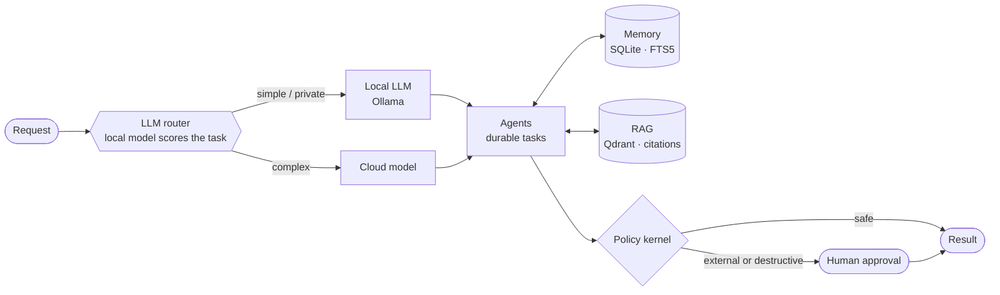

<a href="https://zaiddiab.com">
  <picture>
    <source media="(prefers-color-scheme: dark)" srcset="assets/banner-dark.svg">
    <source media="(prefers-color-scheme: light)" srcset="assets/banner-light.svg">
    
  </picture>
</a>

<p align="center">
  <a href="https://zaiddiab.com"><b>Portfolio</b></a> &nbsp;·&nbsp;
  <a href="https://zaiddiab.com/projects"><b>Case studies</b></a> &nbsp;·&nbsp;
  <a href="https://linkedin.com/in/zaiddiab"><b>LinkedIn</b></a> &nbsp;·&nbsp;
  <a href="https://zaiddiab.com/zaid-diab-cv.pdf"><b>CV</b></a> &nbsp;·&nbsp;
  <a href="mailto:contact@zaiddiab.com"><b>Email</b></a>
</p>

I build **agentic, local-first AI systems**: multi-agent RAG, LLM routing, and durable agents with
human approval gates. I also build the backend, DevOps and Linux plumbing that makes them run outside a demo.

```text
NOW        Building a private, local-first AI operations system
NEXT       Self-hosted home server for local LLMs and always-on agents
SHIPPED    Initial phase of a multi-agent RAG assessment pipeline (team of 5)
BASE       Amman, Jordan · German work authorization through Mar 2027
OPEN TO    Selected AI engineering roles, freelance AI work, collaborations
```

### How I build



<sub>Local first by default, cloud by exception. Evidence over vibes. Nothing irreversible runs without a human.</sub>

### Selected work

Most of my work lives in private repositories, so each item links to a write-up instead.

| | Project | Proof |
|---|---|---|
| 🧠 | **[Private AI Operations System](https://zaiddiab.com/projects/private-ai-operations-system)**<br>Persistent agents, durable tasks, evidence-backed memory and approval-gated actions under one policy kernel. Local models do the work. | Python · FastAPI · SQLite/FTS5 · Ollama |
| 📑 | **[EFQM/RADAR AI Report Analyzer](https://zaiddiab.com/projects/efqm-radar-rag)**<br>Local-first multi-agent RAG for evidence-backed desk assessment. Initial phase delivered: a 573-segment calibration run with zero retrieval or grounding failures. I led a team of five. | LangGraph · Pydantic · Qdrant · 1,360 tests |
| 🔀 | **[LLM Routing System](https://zaiddiab.com/projects/porsche-llm-routing)**, Porsche Digital<br>An on-device LLM decides whether each prompt stays local or goes to the cloud. About 65% stayed local and cloud AI spend fell by about 45% (my own operational estimate). | Local inference · Python |
| 🚗 | **[Vehicle Software & Edge AI](https://zaiddiab.com/projects/porsche-ci-cd-ota)**, Porsche Digital<br>CI/CD for embedded Linux, a Rust OTA updater on test vehicles, and a real-time YOLO + GStreamer dashcam pipeline. | Rust · Docker · GStreamer · YOLO |
| 🛰️ | **[Agent Operations Dashboard](https://zaiddiab.com/projects/agent-operations-dashboard)**<br>An owner-only control surface for projects, PRs, agent telemetry and alerts. | Next.js · Supabase · WebAuthn · MCP |

### Stack

<picture>
  <source media="(prefers-color-scheme: dark)" srcset="assets/stack-dark.svg">
  <source media="(prefers-color-scheme: light)" srcset="assets/stack-light.svg">
  
</picture>

### Activity

<picture>
  <source media="(prefers-color-scheme: dark)" srcset="assets/stats-dark.svg">
  <source media="(prefers-color-scheme: light)" srcset="assets/stats-light.svg">
  
</picture>

<picture>
  <source media="(prefers-color-scheme: dark)" srcset="https://raw.githubusercontent.com/zaiddiab/zaiddiab/output/github-snake-dark.svg">
  <source media="(prefers-color-scheme: light)" srcset="https://raw.githubusercontent.com/zaiddiab/zaiddiab/output/github-snake.svg">
  
</picture>

<details>
<summary><b>Background</b></summary>

- **Porsche Digital GmbH**, Vehicle Solutions & Data, intern, Oct 2025 – Aug 2026
- **BSc Computer Science (AI focus)**, German-Jordanian University, 2026
- **Exchange semester**, Hochschule Trier: robotics, computer vision, AI, 2025
- Arabic (native) · English (C2) · German (B1+)

</details>

<sub>Built with spec-driven development (OpenSpec), AI-assisted engineering and evaluation gates. The cards on this page are generated by GitHub Actions in this repo.</sub>
